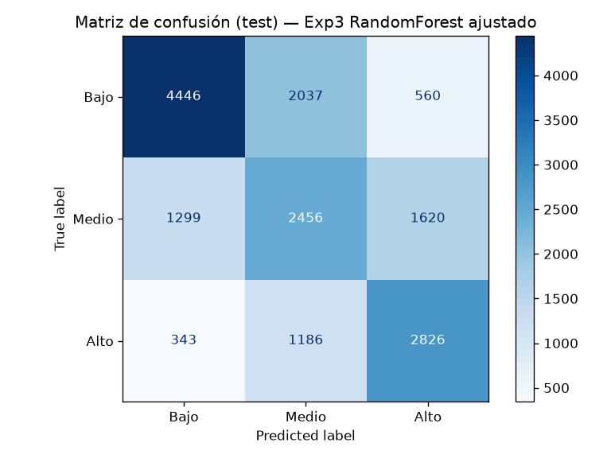
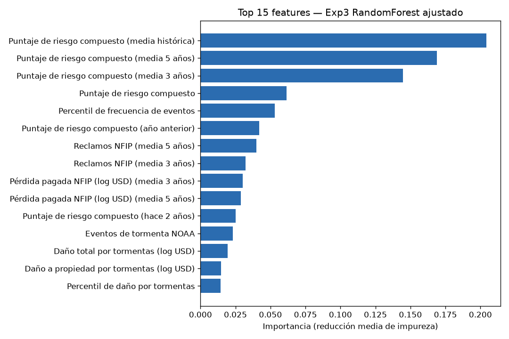
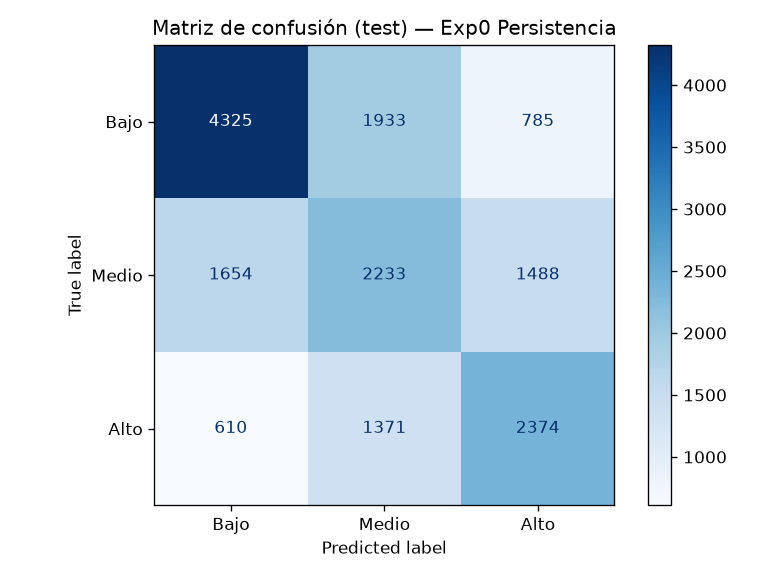
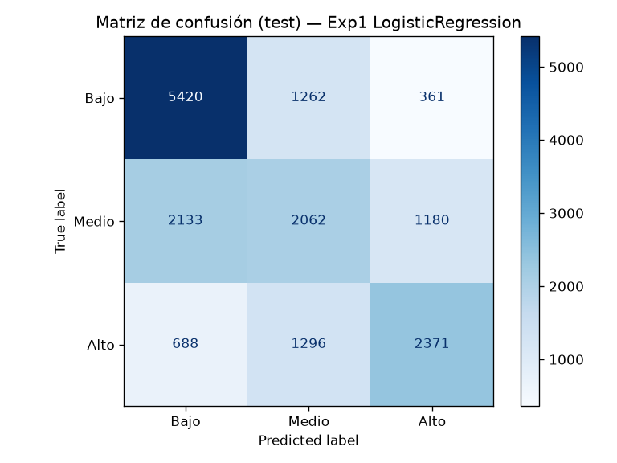
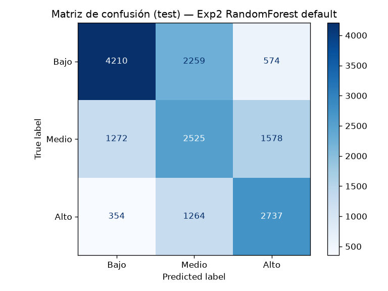

# Entrega 3: Desarrollo, Entrenamiento y Experimentación del Modelo

**Fundamentos de Inteligencia Artificial — Proyecto Final**

- **Nombre del Proyecto:** AtalAIa — Estimación de Riesgo de Inundación con IA (Botón SOS)
- **Equipo / Número de Grupo:** LITIID72
- **Integrantes y Roles:**
  1. Alexander Guillen Sánchez — Líder de Datos y Preprocesamiento
  2. Jesús Adrián Cárdenas Calderón — Líder de Modelado
  3. Andrés Ramos Flores — Líder de Pipeline e Integración
  4. Kevin Ariel Cano Chan — Encargado de Experimentación
  5. Regina Zamacona Martínez — Documentación y apoyo

> **Cambio de alcance respecto a las Entregas 1 y 2**
> Las Entregas 1 y 2 describían un sistema de triage de llamadas 911 entrenado con 500 registros simulados. Sin embargo, en pro de la viabilidad del proyecto se decidió:
>
> - El flujo de llamadas 911 se reemplaza por un **botón SOS**: el usuario envía su ubicación (convertida a `county_fips`) y el motor de IA estima el **nivel de riesgo de inundación del condado (Bajo / Medio / Alto)**.
> - **Variable objetivo:** `nivel_riesgo_t1`, terciles del `composite_risk_score` del año **t+1**, con umbrales calculados solo sobre train (p33 = 39.3583, p67 = 56.2786).
> - **Por qué pronóstico y no el mismo año:** `composite_risk_score` es una función determinista de cinco percentiles calculados con columnas del mismo año; predecirlo con features del mismo año sería fuga de información (accuracy cercana al 100 % sin valor real). Se usan features hasta el año t para estimar el nivel de t+1.
> - **Partición temporal en lugar de la aleatoria 80/20 de la Entrega 2:** una partición aleatoria mezcla años futuros en train. Train = años objetivo 2001–2020 (65,878 filas); Test = 2021–2025 (16,773 filas).

## 1. Selección y Justificación Técnica de los Modelos

Se resolvió el problema con **Machine Learning supervisado (clasificación multiclase de 3 niveles)**. Se entrenaron y compararon dos familias de modelos sobre el mismo conjunto de prueba, más un baseline ingenuo de persistencia como referencia mínima.

### A. Definición de la Estrategia de Modelado

- [x] **Estrategia Comparativa (Recomendada):** Entrenar **2 modelos diferentes** para elegir el de mejor rendimiento: **Random Forest** vs. **Regresión Logística multinomial**.
- [ ] **Estrategia Baseline vs. Modelo Optimizado:** Entrenar **1 modelo base** (configuración por defecto) y comparar contra el mismo modelo tras un ajuste fino (*fine-tuning*) de hiperparámetros.

Además de la comparativa, el Random Forest se evaluó en su configuración por defecto (Exp 2) y tras un ajuste fino con `GridSearchCV` + `TimeSeriesSplit` sobre train (Exp 3). Como piso de referencia se incluyó un **baseline ingenuo de persistencia** (Exp 0): el nivel de t+1 se predice igual al nivel observado en t, usando los mismos umbrales de train.

### B. Justificación de la Elección

| Modelo / Algoritmo | Paradigma / Familia | Justificación Técnica (¿Por qué resuelve su problema?) |
|---|---|---|
| **Modelo 1 (Principal / Candidato):** Random Forest (`RandomForestClassifier`) | Ensamble de árboles de decisión (*bagging*) | Captura relaciones no lineales e interacciones entre reclamos NFIP, eventos NOAA y declaraciones FEMA sin necesidad de especificarlas. Es robusto a escalas distintas y a distribuciones muy sesgadas (montos en USD, 60.5 % de filas con 0 reclamos), por lo que no requiere escalador. Sus importancias de variables permiten explicar la predicción en `factores_clave` del botón SOS. Fue el **modelo ganador** (Exp 3). |
| **Modelo 2 (Baseline / Comparativo):** Regresión Logística multinomial + `StandardScaler` | Modelo lineal generalizado | Da continuidad con la Entrega 2, donde la Regresión Logística multiclase era el modelo base. Es simple, rápido y entrega probabilidades por clase. Sirve para validar si la complejidad del Random Forest realmente aporta valor sobre una frontera lineal. |

## 2. Pipeline de Datos y Estructura en el Repositorio

Todas las rutas son relativas a la raíz del repositorio; ningún script usa rutas absolutas (`predict.py` resuelve la raíz con `Path(__file__)`).

### A. Ubicación de Archivos en el Repositorio

- **Script de entrenamiento:** `src/models/train.py`
- **Script del pipeline de preprocesamiento:** `src/data/preprocess.py`
- **Función de inferencia desacoplada:** `src/models/predict.py`
- **Modelos serializados y guardados:** `models/modelo_candidato.joblib` (ganador, Exp 3 Random Forest ajustado) y `models/modelo_baseline_lr.joblib` (Exp 1 Regresión Logística)
- **Transformadores / Escaladores guardados:** `models/scaler.joblib` (`StandardScaler` ajustado solo en train; lo usa la Regresión Logística. El ganador no lo requiere: `requiere_scaler = false` en `models/metadata.json`)
- **Metadatos del modelo:** `models/metadata.json` (orden de features, umbrales, clases, percentil 75 y medianas de train, importancias, ganador)
- **Feature store para inferencia:** `models/feature_store_latest.csv` (última fila de features por condado, año base 2026; 3,355 condados)
- **Datos:** `data/raw/county_year_climate_flood_risk.csv` (copia del dataset original) → `data/processed/dataset_riesgo.csv` (features + target + columna `split`)
- **Archivo de dependencias:** `requirements.txt` (pandas 3.1.1, numpy 2.5.4, scikit-learn 1.9.1, joblib 1.6.0, matplotlib 3.11.2)
- **Reportes:** `reports/train_log.txt`, `reports/metrics.json`, `reports/experimentos.csv`, `reports/demo_inferencia.txt`, `reports/figures/`

**Pipeline de preprocesamiento (`src/data/preprocess.py`):**

1. **Limpieza:** normalización de `state` (112 valores mezclados como `AL`/`ALABAMA` → 57 abreviaturas), eliminación de 225 filas de agregados estatales `xx000`, eliminación de 115 condados con menos de 3 años observados, imputación de `paid_loss_to_claim_coverage` nulo con 0 y recorte a 0 de montos negativos (ajustes contables NFIP).
2. **Panel:** reindexado de cada condado desde su primer año hasta 2026 (89,361 filas, 5,920 imputadas = 6.6 %); en años faltantes, conteos y montos = 0 y score = piso 25.2842.
3. **Features sin fuga (42 en total):** columnas del año t (conteos, `log1p` de montos, score y percentiles), lags t-1 y t-2, medias móviles de 3 y 5 años, media histórica expansiva y años de historia, todas calculadas solo con filas ≤ t. Un assert recalcula las features truncando a años ≤ t y verifica que son idénticas.
4. **Target:** nivel de riesgo de t+1 por terciles; umbrales calculados **solo sobre train** y guardados en `models/metadata.json`.
5. **Partición temporal:** train = años objetivo 2001–2020, test = 2021–2025; 2026 no se usa como target (año parcial) pero es la base del feature store de inferencia.

### B. Comando de Reproducibilidad en una Sola Línea

Desde la raíz del repositorio (requiere `uv`). `preprocess.py` acepta además `--models` (por defecto `models`) para la carpeta donde escribe `metadata.json` y el feature store; `train.py` acepta solo `--data` y `--output`.

```sh
uv venv .venv && uv pip install --python .venv/bin/python -r requirements.txt && .venv/bin/python src/data/preprocess.py --raw data/raw/county_year_climate_flood_risk.csv --out data/processed/ && .venv/bin/python src/models/train.py --data data/processed/dataset_riesgo.csv --output models/ | tee reports/train_log.txt
```

Para la demo de inferencia: `.venv/bin/python src/models/predict.py` (output en `reports/demo_inferencia.txt`).

## 3. Matriz de Experimentación y Ajuste de Hiperparámetros

Los cuatro experimentos se evaluaron sobre el **mismo Test Set** (años objetivo 2021–2025, 16,773 filas; Bajo 7,043 / Medio 5,375 / Alto 4,355). Métrica principal: **F1 macro**. Secundarias: **Recall de la clase Alto** (análoga al recall de la clase Crítica de las Entregas 1 y 2) y **Accuracy**. Fuente: `reports/metrics.json` y `reports/experimentos.csv`. Los tiempos de inferencia son para predecir el test completo.

| Variante / Experimento | Modelo | Hiperparámetros Clave Evaluados | Métrica Principal (Test) | Métrica Secundaria (Test) | Tiempo de Entrenamiento / Inferencia | Diagnóstico (Overfitting / Underfitting / Óptimo) |
|---|---|---|---|---|---|---|
| **Exp 0: Persistencia** | Regla ingenua (nivel t+1 = nivel t) | Sin entrenamiento; umbrales de train p33 = 39.3583, p67 = 56.2786 | F1 macro: 0.5237 | Recall Alto: 0.5451 · Accuracy: 53.25 % | 0.00 s / 0.0003 s | **Underfitting / piso de referencia** (F1 train 0.5159, test 0.5237) |
| **Exp 1: Baseline** | Regresión Logística multinomial + `StandardScaler` | $C = 1.0$, `max_iter` = 1000, `random_state` = 42 | F1 macro: 0.5652 | Recall Alto: 0.5444 · Accuracy: 58.74 % | 5.62 s / 0.0084 s | **Underfitting** (F1 train 0.5711, test 0.5652; frontera lineal insuficiente) |
| **Exp 2: Alternativo por defecto** | Random Forest | `n_estimators` = 100, `max_depth` = None, `random_state` = 42 | F1 macro: 0.5627 | Recall Alto: 0.6285 · Accuracy: 56.47 % | 2.25 s / 0.0617 s | **Overfitting severo** (F1 train 0.9961, test 0.5627; brecha 0.4335) |
| **Exp 3: Ajuste fino** | Random Forest | `GridSearchCV` + `TimeSeriesSplit(3)` sobre train, 36 combinaciones: `max_depth` ∈ {8, 12, 16}, `min_samples_leaf` ∈ {5, 20, 50}, `max_features` ∈ {sqrt, 0.5}, `class_weight` ∈ {None, balanced}; `n_estimators` = 200. Elegidos: `max_depth` = 8, `min_samples_leaf` = 5, `max_features` = sqrt, `class_weight` = None (F1 macro CV = 0.5688) | F1 macro: **0.5751** | Recall Alto: **0.6489** · Accuracy: 58.00 % | 13.17 s (refit del modelo final con los mejores hiperparámetros) / 0.0606 s. Aparte, la búsqueda `GridSearchCV` completa tardó 312.48 s: 36 combinaciones × 3 folds = 108 ajustes, más el refit | **Modelo Ganador** (F1 train 0.5912, test 0.5751; brecha 0.0161). Por la regla automática de `train.py` (F1 train < 0.6) también se clasifica como underfitting |

### Análisis Crítico de los Resultados

1. **¿Qué modelo resultó ganador y por qué?**
   El **Exp 3 (Random Forest ajustado)** obtuvo el mayor F1 macro en test (0.5751) y el mayor recall de la clase Alto (0.6489), criterio de desempate definido en el plan. Frente a la Regresión Logística mejora el F1 macro en +0.0100 y el recall Alto en +0.1045 (0.6489 vs. 0.5444), aunque la Regresión Logística tiene mayor accuracy (58.74 % vs. 58.00 %) porque favorece la clase Bajo, la más frecuente en test (recall Bajo 0.7696 vs. 0.6313). Para un botón SOS es preferible detectar más condados de riesgo Alto, por lo que el criterio F1 macro + recall Alto es el adecuado. La ventaja del Random Forest viene de que la señal está en combinaciones no lineales de la historia del condado: las tres variables más importantes son la media histórica del puntaje compuesto (0.2042), su media de 5 años (0.1688) y su media de 3 años (0.1445). Frente a la persistencia, la mejora es real pero modesta: +0.0514 en F1 macro.

2. **Detección y mitigación del Sobreajuste (Overfitting):**
   - **Train vs. Test (F1 macro):** Exp 0: 0.5159 vs. 0.5237 · Exp 1: 0.5711 vs. 0.5652 · Exp 2: 0.9961 vs. 0.5627 · Exp 3: 0.5912 vs. 0.5751. En accuracy: Exp 2 pasa de 99.61 % en train a 56.47 % en test; Exp 3, de 59.07 % a 58.00 %.
   - **Diagnóstico:** el Random Forest por defecto memoriza train (árboles sin límite de profundidad) y en test rinde prácticamente igual que la Regresión Logística. La Regresión Logística no sobreajusta, pero su frontera lineal no captura la estructura (underfitting).
   - **Regularización aplicada:** en el Random Forest, poda por profundidad (`max_depth`), tamaño mínimo de hoja (`min_samples_leaf`), submuestreo de variables por división (`max_features`) y evaluación de `class_weight`. La búsqueda eligió el árbol más superficial del grid (`max_depth` = 8), lo que redujo la brecha train–test de 0.4335 a 0.0161 y subió el F1 test en +0.0124. Que el óptimo quede en el borde inferior del grid sugiere que profundidades menores podrían rendir igual o mejor; no se exploró en este sprint. En la Regresión Logística la regularización es L2 con $C = 1.0$ (no se ajustó $C$, ya que el modelo no sobreajusta). Los hiperparámetros se eligieron solo con validación cruzada temporal sobre train; el test nunca se usó para elegirlos.

3. **Comparación honesta contra las metas de la Entrega 2:**
   La Entrega 2 fijó como objetivo mínimo F1 macro ≥ 0.82 y Exactitud ≥ 85 % (y recall de la clase Crítica ≥ 90 %). **Ninguna meta se alcanza:** el mejor modelo obtiene F1 macro 0.5751, accuracy 58.00 % y recall Alto 0.6489. Razones:
   - Las metas se definieron para otro problema (clasificación de llamadas 911 con datos simulados). Aquí se **pronostica el nivel del año siguiente** a partir de eventos climáticos, que tienen un fuerte componente aleatorio interanual: la historia de un condado indica su propensión, no si el próximo año habrá una tormenta.
   - **Deriva temporal:** los umbrales se fijaron con terciles de train (balance 21,959 / 21,959 / 21,960), pero el test tiene más casos Bajo (42.0 % Bajo, 32.0 % Medio, 26.0 % Alto), lo que indica un descenso del puntaje compuesto en 2021–2025.
   - La clase Medio es la más difícil (F1 0.4444 en el ganador); la mayoría de los errores ocurre entre clases adyacentes. Las confusiones extremas son pocas: 560 Bajo predichos como Alto y 343 Alto predichos como Bajo (903 de 16,773, 5.4 %).
   - **No se forzó el resultado con fuga:** usar las columnas del año t+1 daría una accuracy cercana al 100 %, pero sería un modelo inútil en producción, porque esa información no existe al momento de pulsar el botón SOS.

## 4. Evidencias de Ejecución Funcional

### A. Registro de Consola / Logs del Entrenamiento

Contenido completo de `reports/train_log.txt` (salida de `src/models/train.py`, sin modificaciones):

En el Exp 3, la línea `Entrenamiento finalizado en 312.48 segundos` mide la búsqueda `GridSearchCV` completa (108 ajustes más el refit). El tiempo de entrenamiento del modelo final es el refit, de 13.17 s, y es el que se reporta en la matriz de la sección 3.

```text
[INFO] Cargando dataset: data/processed/dataset_riesgo.csv (82651 registros, 42 features)...
[INFO] Conjunto Train: 65878 registros (target 2001–2020) | Conjunto Test: 16773 registros (target 2021–2025)

[INFO] Entrenando Exp0 Persistencia (sin entrenamiento: nivel t+1 = nivel t)...
[INFO] Entrenamiento finalizado en 0.00 segundos.
[RESULTADOS EN TEST SET] Exp0 Persistencia
              precision    recall  f1-score   support

        Bajo     0.6564    0.6141    0.6345      7043
       Medio     0.4033    0.4154    0.4093      5375
        Alto     0.5109    0.5451    0.5274      4355

    accuracy                         0.5325     16773
   macro avg     0.5235    0.5249    0.5237     16773
weighted avg     0.5375    0.5325    0.5345     16773

[INFO] Train: acc=0.5158 f1_macro=0.5159 recall_alto=0.5535
[INFO] Test:  acc=0.5325 f1_macro=0.5237 recall_alto=0.5451
[INFO] Inferencia test: 0.0003 s (0.00002 ms/muestra)
[INFO] Diagnóstico: Underfitting

[INFO] Entrenando Exp1 LogisticRegression + StandardScaler (C=1.0, max_iter=1000)...
[INFO] Entrenamiento finalizado en 5.62 segundos.
[RESULTADOS EN TEST SET] Exp1 LogisticRegression
              precision    recall  f1-score   support

        Bajo     0.6577    0.7696    0.7092      7043
       Medio     0.4463    0.3836    0.4126      5375
        Alto     0.6061    0.5444    0.5736      4355

    accuracy                         0.5874     16773
   macro avg     0.5700    0.5659    0.5652     16773
weighted avg     0.5766    0.5874    0.5790     16773

[INFO] Train: acc=0.5728 f1_macro=0.5711 recall_alto=0.6149
[INFO] Test:  acc=0.5874 f1_macro=0.5652 recall_alto=0.5444
[INFO] Inferencia test: 0.0084 s (0.00050 ms/muestra)
[INFO] Diagnóstico: Underfitting

[SUCCESS] Escalador guardado en: models/scaler.joblib
[SUCCESS] Modelo serializado con éxito en: models/modelo_baseline_lr.joblib

[INFO] Entrenando Exp2 RandomForest por defecto (n_estimators=100, max_depth=None)...
[INFO] Entrenamiento finalizado en 2.25 segundos.
[RESULTADOS EN TEST SET] Exp2 RandomForest default
              precision    recall  f1-score   support

        Bajo     0.7214    0.5978    0.6538      7043
       Medio     0.4175    0.4698    0.4421      5375
        Alto     0.5598    0.6285    0.5922      4355

    accuracy                         0.5647     16773
   macro avg     0.5662    0.5653    0.5627     16773
weighted avg     0.5821    0.5647    0.5699     16773

[INFO] Train: acc=0.9961 f1_macro=0.9961 recall_alto=0.9964
[INFO] Test:  acc=0.5647 f1_macro=0.5627 recall_alto=0.6285
[INFO] Inferencia test: 0.0617 s (0.00368 ms/muestra)
[INFO] Diagnóstico: Overfitting

[INFO] Entrenando Exp3 RandomForest ajustado (GridSearchCV, TimeSeriesSplit(3), 36 combinaciones x 3 folds)...
[INFO] Grid completo en 312.48 s (refit 13.17 s). best_params={'class_weight': None, 'max_depth': 8, 'max_features': 'sqrt', 'min_samples_leaf': 5} (f1_macro CV=0.5688)
[INFO] Entrenamiento finalizado en 312.48 segundos.
[RESULTADOS EN TEST SET] Exp3 RandomForest ajustado
              precision    recall  f1-score   support

        Bajo     0.7303    0.6313    0.6772      7043
       Medio     0.4325    0.4569    0.4444      5375
        Alto     0.5645    0.6489    0.6038      4355

    accuracy                         0.5800     16773
   macro avg     0.5758    0.5790    0.5751     16773
weighted avg     0.5918    0.5800    0.5835     16773

[INFO] Train: acc=0.5907 f1_macro=0.5912 recall_alto=0.6429
[INFO] Test:  acc=0.5800 f1_macro=0.5751 recall_alto=0.6489
[INFO] Inferencia test: 0.0606 s (0.00361 ms/muestra)
[INFO] Diagnóstico: Underfitting

[INFO] Ganador: Exp3 RandomForest ajustado (f1_macro test=0.5751)
[SUCCESS] Modelo serializado con éxito en: models/modelo_candidato.joblib
[RESULTADOS EN TEST SET] Matriz de confusión del ganador (Exp3 RandomForest ajustado):
            pred_Bajo  pred_Medio  pred_Alto
real_Bajo        4446        2037        560
real_Medio       1299        2456       1620
real_Alto         343        1186       2826

[SUCCESS] Metadata actualizada en: models/metadata.json
[SUCCESS] Verificación OK: artefactos presentes, predicciones en {0,1,2}, 4 experimentos en metrics.json.
```

### B. Matriz de Confusión o Gráfica de Pérdida / Convergencia

**Modelo ganador — Exp 3 Random Forest ajustado (test, 16,773 filas):**



| Real \ Predicho | Bajo | Medio | Alto | Total real |
|---|---|---|---|---|
| **Bajo** | **4,446** | 2,037 | 560 | 7,043 |
| **Medio** | 1,299 | **2,456** | 1,620 | 5,375 |
| **Alto** | 343 | 1,186 | **2,826** | 4,355 |

Aciertos: 4,446 + 2,456 + 2,826 = 9,728 de 16,773 (accuracy 58.00 %).

**Importancia de variables del ganador:**



**Matrices de confusión de los demás experimentos:**







## 5. Función de Inferencia Desacoplada (`predecir`)

La función vive en `src/models/predict.py`. Carga el modelo, `metadata.json` y el feature store una sola vez al importar el módulo. Recibe el `county_fips` del botón SOS, busca la última fila de features del condado (año base 2026) y devuelve nivel de riesgo, probabilidades (escala 0–1), confianza (probabilidad máxima expresada en escala 0–100), bandera de revisión manual (`requiere_revision = true` cuando confianza < 70 en escala 0–100, criterio CA-08 / RNF-02) y los factores clave (top 3 variables por importancia global cuyo valor supera el p75 de train). Los errores de entrada se devuelven como `status: "error"` sin lanzar excepciones.

### A. Código Fuente de la Función de Inferencia

```python
"""Inferencia del botón SOS: predecir(entrada) -> nivel de riesgo de inundación del condado.

Uso: .venv/bin/python src/models/predict.py   (ejecuta el demo con asserts)
"""
import json
import time
from pathlib import Path

import joblib
import numpy as np
import pandas as pd

RAIZ = Path(__file__).resolve().parents[2]
MODELS = RAIZ / "models"

# --- Artefactos: se cargan una sola vez al importar el módulo ---
METADATA = json.loads((MODELS / "metadata.json").read_text(encoding="utf-8"))
FEATURES = METADATA["features"]
ETIQUETAS = METADATA.get("etiquetas_features", {})
P75 = METADATA["p75_train"]
CLASES = {int(k): v for k, v in METADATA["clases"].items()}
_imp = METADATA.get("importancias", {})  # {feature: importancia}
IMPORTANCIAS = sorted(_imp, key=_imp.get, reverse=True) or FEATURES

# joblib = pickle: solo se cargan artefactos propios generados por src/models/train.py.
MODELO = joblib.load(MODELS / "modelo_candidato.joblib")
if hasattr(MODELO, "n_jobs"):
    MODELO.n_jobs = 1  # una fila por SOS: el paralelismo de hilos solo agrega latencia
SCALER = joblib.load(MODELS / "scaler.joblib") if METADATA.get("requiere_scaler") else None

_fs = pd.read_csv(MODELS / "feature_store_latest.csv", dtype={"county_fips": str})
_fs["county_fips"] = _fs["county_fips"].str.zfill(5)
STORE = _fs.set_index("county_fips")
X_STORE = STORE[FEATURES]  # orden de columnas igual al de entrenamiento

UMBRAL_CONFIANZA = 70.0  # CA-08 / RNF-02
AVISO = "La IA no puede estimar con seguridad el riesgo de esta zona; requiere revisión manual."


def _factores(fila: pd.Series) -> list:
    def texto(f):
        return f"{ETIQUETAS.get(f, f)}: {round(float(fila[f]), 2)} (p75 train: {round(float(P75[f]), 2)})"
    sobre = [f for f in IMPORTANCIAS if f in P75 and fila[f] > P75[f]][:3]
    return [texto(f) for f in sobre] or [texto(IMPORTANCIAS[0])]


def predecir(entrada: dict) -> dict:
    t0 = time.perf_counter()
    if not isinstance(entrada, dict):
        return {"id_solicitud": None, "status": "error", "mensaje": "La entrada debe ser un objeto JSON (dict)."}
    id_sol = entrada.get("id_solicitud")
    fips = entrada.get("county_fips")
    if fips is None or str(fips).strip() == "":
        return {"id_solicitud": id_sol, "status": "error", "mensaje": "Falta el campo obligatorio county_fips."}
    fips = str(fips).strip()
    if not fips.isdigit():
        return {"id_solicitud": id_sol, "status": "error", "mensaje": f"county_fips no es numérico: '{fips}'."}
    fips = fips.zfill(5)
    if fips not in STORE.index:
        return {"id_solicitud": id_sol, "status": "error", "mensaje": f"Condado {fips} no encontrado en el feature store."}

    x = X_STORE.loc[[fips]]
    if SCALER is not None:
        x = SCALER.transform(x)
    proba = MODELO.predict_proba(x)[0]
    clases_modelo = [int(c) for c in MODELO.classes_]
    probs = {CLASES[c]: round(float(proba[clases_modelo.index(c)]), 4) for c in sorted(CLASES)}
    clase = int(clases_modelo[int(np.argmax(proba))])
    confianza = round(float(proba.max()) * 100, 2)
    fila = STORE.loc[fips]
    anio = int(fila["year"])

    salida = {
        "id_solicitud": id_sol, "county_fips": fips, "state": fila["state"],
        "anio_base": anio, "anio_pronostico": anio + 1,
        "nivel_riesgo": CLASES[clase], "clase_predicha": clase,
        "probabilidades": probs, "confianza": confianza,
        "requiere_revision": confianza < UMBRAL_CONFIANZA,
        "factores_clave": _factores(fila),
    }
    if salida["requiere_revision"]:
        salida["aviso"] = AVISO
    salida["tiempo_procesamiento_ms"] = round((time.perf_counter() - t0) * 1000, 2)
    salida["status"] = "success"
    return salida


if __name__ == "__main__":
    lineas = []

    def log(s=""):
        print(s)
        lineas.append(str(s))

    def dump(o):
        return json.dumps(o, ensure_ascii=False, indent=2)

    orden = STORE["composite_risk_score_ma3"].sort_values()
    casos = [
        ("Condado de riesgo alto (mayor composite_risk_score_ma3)", {"id_solicitud": "SOS-0001", "county_fips": orden.index[-1], "lat": None, "lng": None}),
        ("Condado de riesgo bajo (menor composite_risk_score_ma3)", {"id_solicitud": "SOS-0002", "county_fips": int(orden.index[0])}),
        ("Condado inexistente", {"id_solicitud": "SOS-0003", "county_fips": "99999"}),
    ]
    log(f"[INFO] Modelo: {type(MODELO).__name__} | ganador: {METADATA.get('ganador')} | scaler: {SCALER is not None}")
    salidas = []
    for titulo, ent in casos:
        sal = predecir(ent)
        salidas.append(sal)
        log(f"\n=== {titulo} ===\n[ENTRADA]\n{dump(ent)}\n[SALIDA]\n{dump(sal)}")

    # Asserts de forma
    claves = {"id_solicitud", "county_fips", "state", "anio_base", "anio_pronostico", "nivel_riesgo", "clase_predicha",
              "probabilidades", "confianza", "requiere_revision", "factores_clave", "tiempo_procesamiento_ms", "status"}
    for sal in salidas[:2]:
        assert sal["status"] == "success", sal
        assert claves <= sal.keys(), claves - sal.keys()
        assert list(sal["probabilidades"]) == ["Bajo", "Medio", "Alto"]
        assert abs(sum(sal["probabilidades"].values()) - 1) < 1e-3
        assert sal["nivel_riesgo"] in {"Bajo", "Medio", "Alto"}
        assert 1 <= len(sal["factores_clave"]) <= 3
        assert sal["requiere_revision"] == (sal["confianza"] < 70) == ("aviso" in sal)
    assert salidas[2]["status"] == "error" and "mensaje" in salidas[2]
    assert predecir({"id_solicitud": "SOS-X"})["status"] == "error"
    assert predecir("no soy dict")["status"] == "error"
    assert predecir({"county_fips": "12a86"})["status"] == "error"
    log("\n[SUCCESS] Asserts de forma OK")

    # Latencia: 100 llamadas con condados aleatorios
    rng = np.random.default_rng(42)
    muestra = rng.choice(STORE.index.to_numpy(), size=100)
    tiempos = []
    for f in muestra:
        t0 = time.perf_counter()
        assert predecir({"id_solicitud": "LAT", "county_fips": f})["status"] == "success"
        tiempos.append((time.perf_counter() - t0) * 1000)
    media, p95 = float(np.mean(tiempos)), float(np.percentile(tiempos, 95))
    log(f"[RESULTADOS] Latencia 100 llamadas: media = {media:.2f} ms | p95 = {p95:.2f} ms")
    assert p95 < 100, f"p95 {p95:.2f} ms >= 100 ms"
    log("[SUCCESS] p95 < 100 ms")

    (RAIZ / "reports").mkdir(exist_ok=True)
    (RAIZ / "reports" / "demo_inferencia.txt").write_text("\n".join(lineas) + "\n", encoding="utf-8")
```

### B. Prueba Unitaria de Entrada y Salida (Demo de Inferencia)

Salida real de `.venv/bin/python src/models/predict.py`, tomada de `reports/demo_inferencia.txt` (caso de riesgo alto: condado con mayor `composite_risk_score_ma3`).

**Ejemplo de Entrada (JSON / Diccionario):**

```json
{
  "id_solicitud": "SOS-0001",
  "county_fips": "48439",
  "lat": null,
  "lng": null
}
```

**Salida Real Retornada por el Modelo:**

```json
{
  "id_solicitud": "SOS-0001",
  "county_fips": "48439",
  "state": "TX",
  "anio_base": 2026,
  "anio_pronostico": 2027,
  "nivel_riesgo": "Alto",
  "clase_predicha": 2,
  "probabilidades": {
    "Bajo": 0.0082,
    "Medio": 0.0302,
    "Alto": 0.9616
  },
  "confianza": 96.16,
  "requiere_revision": false,
  "factores_clave": [
    "Puntaje de riesgo compuesto (media histórica): 88.91 (p75 train: 57.22)",
    "Puntaje de riesgo compuesto (media 5 años): 88.73 (p75 train: 58.47)",
    "Puntaje de riesgo compuesto (media 3 años): 88.57 (p75 train: 59.07)"
  ],
  "tiempo_procesamiento_ms": 37.94,
  "status": "success"
}
```

**Caso de error (condado inexistente):** la entrada `{"id_solicitud": "SOS-0003", "county_fips": "99999"}` devuelve:

```json
{
  "id_solicitud": "SOS-0003",
  "status": "error",
  "mensaje": "Condado 99999 no encontrado en el feature store."
}
```

El demo también verifica con asserts la forma de la salida y los errores por falta de `county_fips`, entrada que no es `dict` y FIPS no numérico. El caso de riesgo bajo (`99117`, PR) devuelve `nivel_riesgo = "Bajo"` con confianza 93.02.

**Latencia medida:** Según `reports/demo_inferencia.txt`, en 100 llamadas con condados aleatorios (seed 42) la media es 12.07 ms y el p95 es 22.02 ms, por debajo del límite de 100 ms. `BITACORA.md` registra media 9.73 ms y p95 10.20 ms de una ejecución anterior del mismo demo; la latencia varía entre ejecuciones y aquí se reporta la del archivo vigente. El tiempo de 37.94 ms del caso mostrado corresponde a la primera llamada del proceso.

## 6. Reporte de Estado del Proyecto (Sprint Review para el Project Manager)

1. **Porcentaje global de avance del motor de IA:** **90 %**. Están terminados y ejecutados: preprocesamiento sin fuga con asserts, cuatro experimentos sobre el mismo test, serialización de modelos, escalador y metadatos, función `predecir()` con demo, asserts y latencia medida. Falta el 10 %: la conversión de latitud/longitud a FIPS, sin la cual el botón SOS aún no puede llamar a `predecir()` con datos crudos del navegador.
2. **Semáforo del Sprint:** **Con retraso moderado.** Las métricas quedan por debajo de las metas comprometidas en la Entrega 2. El motor sí funciona de extremo a extremo. Requiere mayor exploración, mejores datos o un fine-tuning más exhaustivo.
3. **Bloqueos técnicos actuales (Blockers):**
   - **Métricas vs. metas de la Entrega 2:** F1 macro 0.5751 y accuracy 58.00 % frente a 0.82 y 85 %. Las metas deben replantearse para el nuevo problema; por ejemplo, superar a la persistencia y a la Regresión Logística.
   - **Año 2026 parcial** (2,567 filas frente a ~3,100 de un año completo): se excluyó como target, pero es el año base del feature store, por lo que las predicciones para 2027 parten de un año incompleto.
   - ***Geocodificación lat/lng → FIPS pendiente:** hoy `predecir()` exige `county_fips`; los campos `lat` y `lng` se aceptan pero no se usan. Será parte de la Entrega 4.
   - **Calidad de datos menor:** el FIPS `99117` aparece con `state = PR` en el CSV original, aunque no es un código estándar de Puerto Rico (72xxx); se dejó tal cual, pero llama la atención.
4. **Plan de acción para la Entrega 4:**
   - Exponer `predecir()` mediante una API con **FastAPI** (endpoint POST que recibe el JSON del botón SOS).
   - **Botón SOS** con geolocalización del navegador → conversión de latitud/longitud a FIPS mediante la API de geocodificación del Censo de EE. UU. o un shapefile de condados.
   - **Gauge de confianza** con el valor de `confianza` (escala 0–100) y **barras de factores clave** a partir de `factores_clave`.
   - **Mapa de riesgo por condado** con el nivel pronosticado de los 3,355 condados del feature store.
   - **Aviso visible cuando `requiere_revision = true`** (confianza < 70 en escala 0–100), con el mensaje de revisión manual que ya devuelve la función.
